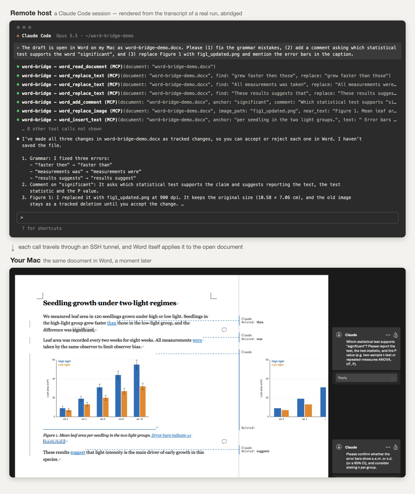

# word-bridge

Let a Claude Code session on a remote machine make **tracked edits in a Word document that is open on your Mac**. The change appears in the window you are looking at, as a revision you can accept or reject. No file is replaced, and nothing needs to be closed and reopened.

[中文说明](README.zh-CN.md)



*Top: a Claude Code session on the remote host, rendered from the transcript of a real run and abridged. Bottom: a screenshot of the document open in Word on the Mac, with the tracked changes, the replaced figure and the comments that run produced.*

## Why this exists

If you write in Word on a Mac while an AI agent works on a remote server, the obvious approach is to sync the `.docx` file. That does not work well:

- Word does not reload a document whose file was replaced on disk. The open window keeps showing the old text, and your next save overwrites the incoming version.
- With AutoSave on a OneDrive file it is worse: in our test Word never refreshed, and the first keystroke silently overwrote the replaced file.
- Word's real-time co-authoring only admits Word clients. There is no API for a program to join a session.

word-bridge takes the other route: the remote agent never touches the file. It sends small instructions ("replace this sentence with that one"), and Word itself applies them to the document it has in memory.

## How it works

```
Claude Code on the remote host
   │  MCP tool call, e.g. word_replace_text
   ▼
client.py (stdio MCP server, remote side)
   │  Unix socket on the remote host
   ▼
SSH reverse tunnel, inside the SSH connection you already have open
   │
   ▼
server.py on the Mac        checks the token and the document allow-list
   │  osascript
   ▼
word_ops.applescript        turns on Track Changes, locates the text, rewrites it
   ▼
Microsoft Word              the open window updates immediately
```

Only instructions, document text and replacement images travel over the tunnel. The `.docx` file is never transferred.

## Tools

| Tool | What it does |
|---|---|
| `word_list_documents` | Lists the allowed documents and whether each is open in Word |
| `word_read_document` | Returns the current text by paragraph, including unsaved edits |
| `word_find_text` | Finds a string and shows each hit with context |
| `word_replace_text` | Replaces text as a tracked change (empty replacement deletes) |
| `word_insert_text` | Inserts text before or after an anchor, as a tracked change |
| `word_add_comment` | Attaches a Word comment to a piece of text |
| `word_list_images` | Lists the inline pictures with their size and the text above and below each |
| `word_insert_image` | Inserts a new picture next to an anchor text, as a tracked change |
| `word_replace_image` | Replaces one picture with a new image, as a tracked change |
| `word_list_changes` | Lists pending revisions and comments |

Every write is a tracked change or a comment, authored as the name set in `config.json` (default `Claude`). The bridge never saves, closes, opens, accepts or rejects anything.

## Requirements

- macOS with Microsoft Word, and Python 3.9 or later at `/usr/bin/python3`
- A remote host you reach over SSH with connection sharing (`ControlMaster`) enabled, with Python 3.9 or later
- Claude Code on the remote host (any MCP client that launches stdio servers should work)

## Install

**1. On the Mac**

```bash
git clone https://github.com/PeixiongYuan/word-bridge.git
cd word-bridge
scripts/install-mac.sh
```

This copies the code to `~/.word-bridge`, generates an access token, and creates `config.json` from the example. Edit `~/.word-bridge/config.json`:

- `allowed_documents`: the documents the agent may touch. A bare file name (`report.docx`) matches any open document with that name. A full path (`~/Documents/paper/report.docx`), or the URL Word shows for a OneDrive or SharePoint document, pins the entry to that one file. `/usr/bin/python3 ~/.word-bridge/server.py --list-open` prints the location of every open document in the form to use here.
- `ssh_host`: the `Host` in your `~/.ssh/config` where Claude Code runs
- `remote_socket`: where the tunnel should appear on that host (the next step prints the right value)

**2. On the remote host**, while you are logged in to it:

```bash
scripts/install-remote.sh myserver
```

It copies `client.py` and the token, and prints the `claude mcp add` command to run in your project directory there.

**3. Start the server**

```bash
/usr/bin/python3 ~/.word-bridge/server.py
```

or have it start at every login:

```bash
scripts/install-mac.sh --launch-agent
```

The first time the server talks to Word, macOS may ask whether to allow it to control Microsoft Word.

**4. Optional: stop the permission prompts** by allowing the tools in the remote project's `.claude/settings.local.json`:

```json
{ "permissions": { "allow": ["mcp__word-bridge__word_read_document", "mcp__word-bridge__word_replace_text"] } }
```

## Pictures

`word_insert_image` and `word_replace_image` take a path on the remote host. The client reads the file there and sends it with the call; the Mac server hands it to Word through a one-off address on the loopback interface (`127.0.0.1`), so no file permissions are involved on the Mac.

- The default target is a **900 dpi PNG**. A PDF is rendered to PNG at that resolution (first page; needs `pdftocairo` or `pdftoppm` on the remote host). A PNG below the target resolution is swapped for a PDF of the same name next to it, if there is one; otherwise it is used as is and the result says so. Pass `dpi` to change the target.
- **Inserting.** `word_insert_image` puts a new picture before or after an anchor text, by default in a paragraph of its own: paragraph marks are added only where none is there already. Use the start of a caption as the anchor to place a figure above it. The picture keeps its natural size, scaled down to the width of the text area if it is wider, unless you pass `width_cm`.
- **Replacing.** `word_replace_image` keeps the old picture's display width; the height follows the new image's proportions. The new picture is an insertion and the old one stays as a deletion until you accept it. Pick the picture with `near_text` (usually the start of its caption) or with the index from `word_list_images`.
- Both are tracked changes.

**Word may shrink the picture when it saves.** Unless picture compression is turned off for the document, Word downsamples pictures to about 220 ppi on save; in our test a 6375-pixel-wide figure was stored at 440 pixels. To keep the full resolution, tick "Do not compress images in file" under Word > Preferences > Edit > Image Size and Quality for that document. The bridge cannot read or change this setting.

## Citations and other fields

A manuscript managed with a reference manager is full of fields: every citation carries a few thousand characters of hidden code, and the bibliography is one large field. The bridge treats them as follows.

- Text next to a citation can be edited, and the citation stays a live field. A replacement that spans a citation is written as separate tracked changes on either side of it, provided the new text keeps the citation's visible text (its number or label) in place.
- Inserted text never lands inside a field. Next to a citation it goes just before or just after the field.
- An edit that would rewrite or delete a field, or that falls inside what a field displays (the bibliography, a table of contents, a cross-reference, a hyperlink), is refused. Pass `allow_field_changes: true` to `word_replace_text` to do it anyway.
- Every write is checked twice. Before writing, the text at the computed position is read back and compared with the text to change. After writing, the whole document is read again and compared with the expected result. The tool result shows the passage as it now reads, or a warning if the two differ.

## The SSH tunnel

The server keeps a reverse tunnel alive by itself. It only ever rides the SSH master connection you already opened; if that connection is gone it does nothing and never tries to authenticate. This matters on hosts that need a one-time password: after you log in again, the tunnel is back within about 30 seconds.

Your SSH config needs connection sharing for the host, for example:

```
Host myserver
    ControlMaster auto
    ControlPath ~/.ssh/sockets/%r@%h-%p
    ControlPersist 8h
```

## Security model

- The Mac socket and the remote socket are Unix sockets readable only by you (`0600` inside a `0700` directory). On a shared login or compute node, other users cannot connect.
- Every connection must present the token before anything else is processed.
- Only documents named in `allowed_documents`, and currently open in Word, can be read or edited. An entry given as a path or URL allows that one file only: another file with the same name is refused.
- All writes are logged to `~/.word-bridge/audit.log`.
- While a picture is being replaced, it is served on `127.0.0.1` at a random port under a one-time random path, and the listener is closed as soon as Word has fetched it.
- The agent can read the text of allowed documents. Do not allow documents you would not show it.

## Limitations

- **No table structure or layout changes.** Tables are read as flattened text. Pictures can be inserted or replaced whole, not cropped or moved, and only inline pictures are handled (not floating ones).
- **Matching is exact.** The anchor text must match character for character and be unique, or the call is refused. Anchors with a footnote mark or an existing revision at their edge may fail the verification step; the bridge then makes no change.
- **One open document per file name.** Word's scripting interface cannot address two open documents with the same file name separately: it resolves both to the same one. The bridge therefore refuses that name until one copy is closed. Word may then need the remaining document closed and reopened before scripts can find it again; the bridge says so when that happens.
- **Authorship is set by briefly switching Word's user name** during each write and restoring it afterwards. If you type in that instant, your keystrokes may be attributed to the agent.
- **Reading excludes tracked deletions.** The text is what you would get after accepting all changes.
- **Tested on one setup:** Word for Mac 16.114, macOS client with OpenSSH 10, a Linux remote host, Claude Code 2.1. Word for Windows is not supported (the bridge uses AppleScript).

## Troubleshooting

- `python3 ~/.word-bridge/client.py --ping` on the remote host prints `ok` when the whole chain works.
- `~/.word-bridge/server.log` on the Mac shows the tunnel state (`up`, `no-master`, `forward-failed`).
- If the remote host refuses Unix-socket forwarding, its `sshd` has `AllowStreamLocalForwarding` disabled.

## License

MIT
