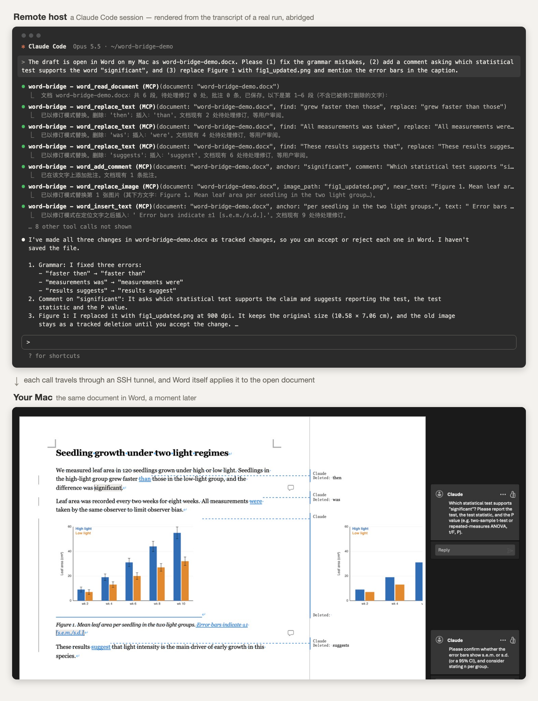

# word-bridge

让远程机器上的 Claude Code **直接修改你 Mac 上 Word 里开着的文档**。改动以修订形式立刻出现在你眼前的窗口里，由你逐条接受或拒绝。不替换文件，也不需要关闭重开。

[English](README.md)



*上：远程主机上的 Claude Code 对话，根据一次真实运行的记录排版，有删节。下：Mac 上 Word 窗口的截图，显示这次运行产生的修订、被替换的图片和批注。*

## 为什么做这个

在 Mac 上用 Word 写稿、同时让远程服务器上的 AI 帮忙改，最直接的想法是同步 `.docx` 文件。但这条路走不通：

- 磁盘上的文件被替换后，Word 不会重新加载。窗口里还是旧内容，你下一次保存就把新版本覆盖了。
- 放在 OneDrive 并开启自动保存更糟：实测中 Word 一直没有刷新，而且一打字就把替换进来的文件悄悄覆盖了。
- Word 的实时协作只接受 Word 客户端加入，没有给程序用的接口。

word-bridge 换了个方向：远程的 Claude 不碰文件，只发“把这句改成那句”的指令，由 Word 自己修改它内存里的那份文档。

## 工作原理

```
远程主机上的 Claude Code
   │  调用 MCP 工具，例如 word_replace_text
   ▼
client.py（远程主机上的 stdio MCP 服务）
   │  远程主机上的 Unix 套接字
   ▼
SSH 反向隧道（藏在你已经打开的那条 SSH 连接里）
   │
   ▼
Mac 上的 server.py          核对口令和文档白名单
   │  osascript
   ▼
word_ops.applescript        开启修订、定位文字、改写
   ▼
Microsoft Word              打开的窗口立刻更新
```

隧道里只传指令、文档文本和用来替换的图片。`.docx` 文件本身从不传输。

## 工具

| 工具 | 作用 |
|---|---|
| `word_list_documents` | 列出允许操作的文档，以及是否已在 Word 中打开 |
| `word_read_document` | 按段落返回当前内容，包括未保存的修改 |
| `word_find_text` | 查找一段文字，返回每处的上下文 |
| `word_replace_text` | 以修订模式替换文字（替换为空即删除） |
| `word_insert_text` | 以修订模式在定位文字前后插入 |
| `word_add_comment` | 在一段文字上加批注 |
| `word_list_images` | 列出嵌入式图片，以及每张的尺寸和上下方文字 |
| `word_replace_image` | 以修订模式把一张图片整张替换成新图 |
| `word_list_changes` | 列出待处理的修订和批注 |

所有写入都是修订或批注，署名取自 `config.json`（默认 `Claude`）。桥接从不保存、关闭、打开文档，也从不接受或拒绝修订。

## 环境要求

- 装有 Microsoft Word 的 macOS，`/usr/bin/python3` 为 Python 3.9 或更高
- 一台通过 SSH 连接的远程主机，SSH 开启了连接复用（`ControlMaster`），有 Python 3.9 或更高
- 远程主机上的 Claude Code（其他能启动 stdio 服务的 MCP 客户端应该也可以）

## 安装

**1. 在 Mac 上**

```bash
git clone https://github.com/PeixiongYuan/word-bridge.git
cd word-bridge
scripts/install-mac.sh
```

脚本把代码装到 `~/.word-bridge`，生成访问口令，并按示例创建 `config.json`。然后编辑 `~/.word-bridge/config.json`：

- `allowed_documents`：允许操作的文档文件名
- `ssh_host`：运行 Claude Code 的那台主机在 `~/.ssh/config` 里的 `Host` 名
- `remote_socket`：隧道在远程主机上的位置（下一步会打印正确的值）

**2. 在远程主机上**（保持已登录状态）：

```bash
scripts/install-remote.sh myserver
```

脚本会复制 `client.py` 和口令，并打印需要在远程项目目录里执行的 `claude mcp add` 命令。

**3. 启动服务**

```bash
/usr/bin/python3 ~/.word-bridge/server.py
```

或者设为每次登录自动启动：

```bash
scripts/install-mac.sh --launch-agent
```

服务第一次访问 Word 时，macOS 可能会询问是否允许它控制 Microsoft Word。

**4. 可选：免去逐次确认**，在远程项目的 `.claude/settings.local.json` 里允许这些工具：

```json
{ "permissions": { "allow": ["mcp__word-bridge__word_read_document", "mcp__word-bridge__word_replace_text"] } }
```

## 替换图片

`word_replace_image` 接收的是远程主机上的文件路径。客户端在那边读取文件并随调用发送；Mac 端服务通过回环地址（`127.0.0.1`）上的一次性地址把图片交给 Word，所以 Mac 上不涉及任何文件权限。

- 默认目标是 **900 dpi 的 PNG**。给 PDF 时按这个分辨率渲染成 PNG（取第一页，远程主机上需要有 `pdftocairo` 或 `pdftoppm`）。给的 PNG 分辨率不足、而旁边有同名 PDF 时，改用该 PDF 渲染；没有同名 PDF 就按原样使用，并在结果里说明。可以用 `dpi` 参数改目标分辨率。
- 新图沿用旧图的显示宽度，高度按新图的比例调整。
- 替换是带修订的：新图记为插入，旧图以删除修订保留，直到你接受。
- 用 `near_text`（通常取图注开头的文字）或 `word_list_images` 给出的序号指明换哪一张。

**Word 保存时可能把图片压小。** 文档没有关闭图片压缩时，Word 保存会把图片降到约 220 ppi；实测中一张 6375 像素宽的图被存成了 440 像素。要保留原始分辨率，需要为这份文档在 Word 的 偏好设置 → 编辑 → 图像大小和质量 中勾选“不压缩文件中的图像”。桥接读不到也改不了这个设置。

## SSH 隧道

服务会自己维持反向隧道。它只复用你已经打开的 SSH 主连接；主连接不在时什么也不做，绝不自己发起登录。这对需要动态口令的主机很重要：你重新登录之后，隧道大约 30 秒内自动恢复。

SSH 配置里需要为这台主机开启连接复用，例如：

```
Host myserver
    ControlMaster auto
    ControlPath ~/.ssh/sockets/%r@%h-%p
    ControlPersist 8h
```

## 安全模型

- Mac 端和远程端都是只有你本人可访问的 Unix 套接字（`0700` 目录里的 `0600` 文件）。在共享的登录节点或计算节点上，其他用户连不上。
- 每条连接必须先出示口令，否则直接断开。
- 只有写在 `allowed_documents` 里、并且此刻在 Word 里打开的文档才能被读取或修改。
- 所有写操作记入 `~/.word-bridge/audit.log`。
- 替换图片期间，图片在 `127.0.0.1` 的随机端口、一次性随机路径下提供，Word 取走后立即关闭。
- 远程的 Claude 能读到白名单文档的文字内容，不想让它看到的文档不要加进白名单。

## 局限

- **不能改表格结构和版式。** 表格读出来是展平的文字。图片只能整张替换，并且只支持嵌入式图片，不支持浮动图片。
- **严格匹配。** 定位文字必须逐字符一致且唯一，否则拒绝执行。定位文字里夹着引文域、脚注标记或已有修订时，复核可能不通过，这时桥接不做任何修改。
- **按文件名识别文档，不看路径。** 两个同名文件无法区分。
- **署名靠临时切换 Word 用户名实现**，每次写入时切换、写完恢复。恰好在那一瞬间你也在打字的话，那几个字可能被记到 Claude 名下。
- **读取不含已被修订删除的文字**，相当于接受全部修订之后的样子。
- **只在一套环境上测试过：** Word for Mac 16.114、macOS 上的 OpenSSH 10、Linux 远程主机、Claude Code 2.1。不支持 Windows 版 Word（桥接用的是 AppleScript）。

## 排查问题

- 在远程主机上运行 `python3 ~/.word-bridge/client.py --ping`，整条链路正常时输出 `ok`。
- Mac 上的 `~/.word-bridge/server.log` 会记录隧道状态（`up`、`no-master`、`forward-failed`）。
- 远程主机拒绝 Unix 套接字转发时，说明它的 `sshd` 关闭了 `AllowStreamLocalForwarding`。

## 许可证

MIT
